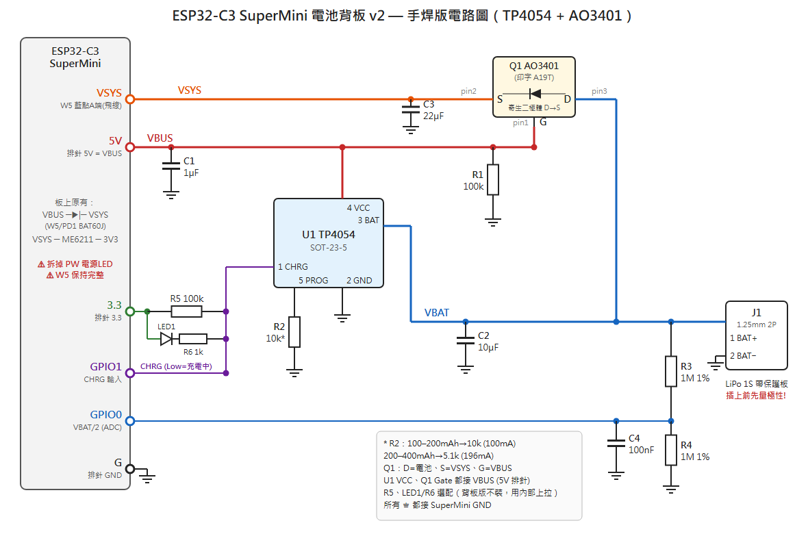
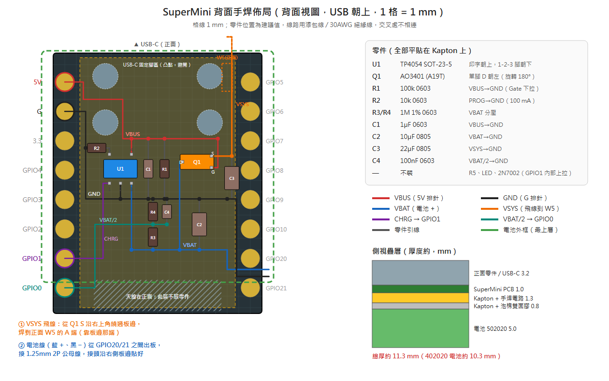

# ESP32-C3 SuperMini 背板電池模組 v2（Battery Backpack）

把充電、電源切換、電量偵測做在一片 **18 × 22.5 mm 的背板小 PCB** 上，疊在 SuperMini 背面，鋰電池用 **小型 2P 連接器** 插拔。

> v1（`SUPERMINI_BATTERY_DESIGN.md`、`WIRING_DIAGRAM.md`）保留作為紀錄，**新製作請以本文件為準**。v1 → v2 的差異與原因見第 1 節。

---

## 0. 一頁摘要

| 項目 | v2 設計 |
|------|---------|
| 充電 IC | TP4054（SOT-23-5），預設 R_PROG = 10 kΩ → **100 mA** |
| 電源路徑 | **Load-sharing**：USB 經板上 PD1 (BAT60J) 供 VSYS；電池經 P-MOS (AO3401A) 供 VSYS，Gate 接 VBUS |
| 板子改造 | **不再改 W5/PD1**（若 v1 已抬腳，要焊回去）；**拆掉電源 LED 或 UR7** |
| 與 SuperMini 連接 | `5V(VBUS) / GND / GPIO1 / GPIO0` 焊墊 + **1 條飛線到 PD1 陰極（VSYS，藍點 A）** |
| 電量偵測 | 1 MΩ / 1 MΩ 分壓 + 100 nF → GPIO0 (ADC1_CH0)，常駐約 2 µA，不需 MOSFET/GPIO 控制 |
| 充電狀態 | TP4054 CHRG → GPIO1（內部上拉；R5、LED 選配） |
| 電池連接器 | **Molex PicoBlade 1.25 mm 2P SMD 臥貼**（53261-0271 或相容 MX1.25），替代：JST PH 2.0（S2B-PH-SM4-TB） |
| 電池 | 帶保護板的單節 LiPo，例如 402025（~150 mAh）/ 502025（~200 mAh） |
| Deep sleep 整機電流 | 約 **45 µA**（拆 LED 後，主要是板上 ME6211 LDO）；換低 Iq LDO 可降到 ~10 µA（選配） |
| 與 E-Paper 腳位 | 只用 GPIO0、GPIO1，**不衝突**（E-Paper 用 2/3/4/5/6/10） |

---

## ★ 手焊版（最終版，直接照這節做）



（向量檔：[BACKPACK_V2_SCHEMATIC.svg](BACKPACK_V2_SCHEMATIC.svg)）

用 TP4054 + AO3401 搭在 Kapton 膠帶上、貼在 SuperMini 背面，和 v1 實板的做法相同。**2N7002 不需要**：電量偵測改用高阻分壓，不用開關，省一顆元件和一支 GPIO。

### 先改 SuperMini
1. 拆掉「PW」旁的紅色電源 LED（或它的電阻）。
2. **W5 保持完整**。v1 實板如果抬過 W5 的一端，焊回去。
3. 找出 W5 的 VSYS 端（藍點 A）：三用電表二極體檔，紅棒接 5V 排針，黑棒輪流碰 W5 兩端。讀到 **0.2–0.35 V 的那一端就是 VSYS**；讀到 0 V（直通）的是 VBUS 端。

### AO3401（A19T）腳位
方向同 [`docs/AO3401.JPG`](../../docs/AO3401.JPG)（Top View，印字朝上、單獨那支腳朝右，和 v1 實板照片的擺法一樣）：

```
                   ┌──────────┐
 VBUS(5V排針) ── G ┤          │
 + 100k 到 GND     │   A19T   ├ D ── 電池 +（VBAT）
 VSYS(W5 A端) ── S ┤          │
                   └──────────┘
```

> 和 v1 實板的差別：v1 是 **S = 電池、D = 5V 排針、G = W5**。v2 改成 **D = 電池、S = VSYS、G = 5V 排針**。

### 接線表（照這張焊）

| # | 從 | 到 | 線色建議 | 備註 |
|---|----|----|----------|------|
| 1 | SuperMini **5V 排針** | U1 pin4 VCC、Q1 pin1 G | 紅 | VBUS 網路 |
| 2 | Q1 pin1 G | R1 100k → GND | — | Gate 下拉 |
| 3 | U1 pin4 VCC | C1 1µF → GND | — | 電容貼近 U1 |
| 4 | U1 pin3 BAT | Q1 pin3 D、J1 BAT+、C2 10µF → GND、R3 上端 | 藍 | VBAT 網路 |
| 5 | Q1 pin2 S | **W5 藍點 A 端**（VSYS） | 橘 | 飛線越短越好，用較粗的線（≥ 28AWG） |
| 6 | Q1 pin2 S | C3 22µF → GND | — | 選配，WiFi 尖峰補強 |
| 7 | U1 pin5 PROG | R2 → GND | — | 10k = 100 mA；5.1k = 196 mA |
| 8 | U1 pin2 GND、J1 BAT− | SuperMini **GND 排針** | 黑 | 所有 GND 匯到這裡 |
| 9 | R3 1M 下端 = R4 1M 上端 = C4 100nF | SuperMini **GPIO0** | — | R4、C4 另一端接 GND |
| 10 | U1 pin1 CHRG | SuperMini **GPIO1** | 紫 | 充電中 = Low；用 GPIO1 內部上拉 |
| 11 | （選配）R5 100k：3.3 排針 → CHRG；LED1 + R6 1k：3.3 → CHRG | — | — | 背面塞電池時 LED 看不到，**背板版不裝** |

電池端：SuperMini 這側焊一段 **1.25 mm 2P 公母對插線**的其中一頭（手焊比 SMD 座容易），電池接另一頭。**每顆新電池插上前，先量極性**。

### 焊完立刻驗證（不接電池）
| 量測（二極體檔） | 正確結果 |
|------------------|----------|
| 紅棒 VBAT、黑棒 VSYS | 0.5–0.7 V（Q1 寄生二極體，方向正確） |
| 紅棒 VSYS、黑棒 VBAT | 不通 |
| 5V 排針 ↔ Q1 pin3 D | 不直接相連（v1 實板是直接相連，這就是過充路徑） |

接著照第 6 節 Step 4 做插拔測試。充飽後拔掉 USB，量電池電壓應 **≤ 4.2 V**。

---

## ★ 背面佈局：把電路和電池塞到 SuperMini 背面



（向量檔：[BACKPACK_V2_LAYOUT.svg](BACKPACK_V2_LAYOUT.svg)，背面視圖，USB 朝上，1 格 = 1 mm）

### 背面的空間限制
SuperMini 是單面板，背面平整（參考 `docs/esp32_c3_supermini_pinout.jpg`）。但有幾個地方要避開：

| 區域 | 位置（背面視圖） | 處理 |
|------|------------------|------|
| 左右兩排排針焊墊 | 左：5V、G、3.3、GPIO4–0；右：GPIO5–21 | 零件放在兩排中間約 13 mm 寬的區域 |
| USB-C 4 支固定腳 | 上方 0–7 mm，左右各兩個凸點 | 只走線、不放零件；整面先貼 Kapton |
| 天線 | 正面最下方約 3 mm | 下方不放零件；電池盡量不要蓋到 |
| W5 | 正面右上角（背面視圖） | VSYS 飛線從右上角繞過板邊焊上去 |

> 背面不要再焊排針：直接把線焊在半孔焊墊上。若一定要插麵包板，排針改從**正面**往上焊。

### 佈局方式：三條匯流線 + 零件跨接
1. **VBUS**（紅）：5V 焊墊 → 從兩排 USB 固定腳中間（y ≈ 4 mm）穿過 → 往下接成 y ≈ 7.4 mm 的橫線。
2. **GND**（黑）：G 焊墊 → 沿左排內側往下 → 接成 y ≈ 12.6 mm 的橫線。
3. **VBAT**（藍）：y ≈ 17 mm 的橫線。
4. 零件放在匯流線之間：
   - C1、R1 跨 VBUS↔GND
   - C2 跨 GND↔VBAT
   - R4/R3 串在 GND↔VBAT 之間，中點拉到 GPIO0；C4 從中點接 GND
5. U1 在左、Q1 在右：
   - Q1 旋轉 180°，單腳 D 朝左往下接 VBAT
   - S（右上）沿右側往上繞過板邊接 W5
   - G（右下）往上接 VBUS
6. CHRG（紫）沿左側往下接 GPIO1；VBAT/2（綠）接 GPIO0。
7. 電池線從右側 GPIO20/21 兩個焊墊之間出板，接 1.25 mm 公母線，接頭沿右側板邊貼好。

### 疊層與組裝順序
1. 拆電源 LED，確認 W5 完整。
2. 背面整面貼一層 Kapton（只露出 5V、G、GPIO1、GPIO0 焊墊）。
3. 照佈局圖把零件平貼、用漆包線 / 30AWG 絕緣線連接。交叉處不相連。
4. 焊 VSYS 飛線到正面 W5 的 A 端。
5. 依「焊完立刻驗證」表量測。
6. 再貼一層 Kapton 蓋住電路，貼 0.5–1 mm 泡棉雙面膠，放上電池。

| 層 | 厚度 (mm) |
|----|-----------|
| 正面零件 / USB-C | 3.2 |
| PCB | 1.0 |
| Kapton + 手焊電路 | 1.3 |
| Kapton + 泡棉膠 | 0.8 |
| 電池 502020（或 402020） | 5.0（4.0） |
| **總厚** | **約 11.3（10.3）** |

### 電池選擇（背面版）
- 可用面積約 18 × 20 mm。上方不能超出板邊，會擋到 USB 插頭；下方盡量不要蓋到天線。
- 建議 **402020（~110 mAh）或 502020（~150 mAh）**，寬度可左右各超出 1 mm。
- 電池保護板那端朝右（GPIO5–21 那側），出線最短。
- 裝好後比較裝電池前後的 WiFi RSSI。若下降超過約 6 dB，把電池往上移一點，或改用側面外掛的較大電池。
- 充電電流用 R2 = 10k（100 mA）。TP4054 被壓在電池下面，不要用更大的電流。

---

## 1. v1 設計檢討（為什麼要改）

讀過 v1 文件並對照 `docs/esp32-c3-supermini-schematic.png` 後，問題如下（依嚴重度排序）：

### 1.1 ❗ 電源切換 P-MOS 方向接反，且插 USB 時 VSYS 沒有供電路徑

v1 接法：W5 的 VSYS 端抬起，AO3401 **S = 電池、D = VSYS**，Gate = USB。

- 插 USB 時 Gate ≈ 4.7 V > Source（電池 3.7–4.2 V），P-MOS 關閉。
- P-MOS 的寄生二極體方向是 **D → S**（VSYS → 電池），電池無法經二極體供電給 VSYS。
- W5 的 VSYS 端已斷開，所以 USB 也無法供電給 VSYS。
- 結果：**照文件接，插著 USB 時 ESP32 沒有電源**。

如果你的實板「插 USB 也能跑」，最可能是 AO3401 實際焊成 D/S 對調。這時系統其實靠 MOS 的寄生二極體從**電池**取電（壓降 0.5–0.7 V），USB 只是在幫電池充電，這不是真正的電源路徑（power path）。副作用包括：

- 系統負載一直掛在電池上，TP4054 看到的電流 = 充電 + 系統耗電，**充飽判斷（C/10 截止）可能一直不會發生**，電池長時間掛在 4.2 V 浮充。
- 電池沒電時插 USB，系統要等電池充到一定電壓才開得了機。

> 另外，未合併的分支 `copilot/update-battery-management-system`（2026-01-11）改為「W5 保持原狀、TP4054 VCC 與 AO3401 Gate 接 VSYS」。方向對了一半，但仍有問題：
> - 拔 USB 後 VSYS 由電池經 MOS 供電，Gate 又接在 VSYS 上，Vgs ≈ 0，MOS 會自己關掉。
> - TP4054 VCC 在電池供電時會吃到電池電壓。
>
> v2 把 Gate 與 TP4054 VCC 改接 **VBUS**（PD1 之前），就能解決這兩點。

**v2 解法**：標準 load-sharing 接法，P-MOS **D = 電池、S = VSYS**，W5/PD1 保持原狀，詳見第 3 節。

### 1.2 ❗ 板上電源 LED 會持續耗電

原廠電路：`VSYS → UR7 5.1 kΩ → CD1 紅色 LED → GND`。用電池供電時約 (3.7 − 1.8) / 5.1k ≈ **0.37 mA，24 小時不停**。

- 每天約 8.9 mAh，**比 v1 估算的整日耗電 4.13 mAh 還多一倍以上**。
- v1 的「500 mAh 可撐 121 天」實際上大概只有 1/3。
- **解法**：拆掉 CD1 或 UR7（PCB 上「PW」字樣旁的小 LED）。

### 1.3 Deep sleep 電流估算過於樂觀

v1 用 ESP32-C3 晶片本身的 5 µA 估算，但 SuperMini 板上 LDO **ME6211** 本身的靜態電流約 40 µA。實測回報顯示，拆掉電源 LED 後整板 deep sleep 約 43 µA。（`OFFICIAL_DESIGN_GUIDE.md` 寫 ME6211 為 3 µA，不正確。）

### 1.4 ADC 分壓開關接法有漏電，且超出腳位電壓

v1：`VBAT → 100k → GPIO0 → 100k → 2N7002 → GND`（低邊開關）。

- 2N7002 關閉時，GPIO0 經 100 kΩ **直接被拉到電池電壓（最高 4.2 V）**，超過 ESP32-C3 腳位上限 VDD + 0.3 V = 3.6 V。電流會經 ESD 二極體灌進 3V3，所以「平時 0 µA」並不成立。
- 控制腳用 **GPIO2，它是 strapping pin**，加 10 kΩ 下拉有開機模式風險，又和 E-Paper 的 SCLK 衝突。
- **v2 解法**：改用高阻抗分壓 1 MΩ/1 MΩ + 100 nF，常駐約 2 µA（只占整機 deep sleep 電流的 5%），省掉 MOSFET、電阻和一支 GPIO，GPIO0 永遠不會超過 2.1 V。

### 1.5 文件內部不一致

| 項目 | v1 文件中的寫法 | 正確 |
|------|----------------|------|
| TP4054 腳位 | 有兩種版本（Pin1=GND / Pin2=PROG） | **1 CHRG、2 GND、3 BAT、4 VCC、5 PROG**（見 `docs/TP4054.JPG`） |
| 10 kΩ PROG | 130 mA | **100 mA**（I = 1000 V / R_PROG） |
| PROG 電阻 | 3 kΩ、10 kΩ 混用 | v2 統一依電池容量選（第 4.3 節） |
| ADC 換算 | `×3.3`、`×2.5` 混用 | 用 ESP-IDF `adc_cali` 曲線校正，直接取 mV |
| 「5V」腳位 | 當成 VSYS 使用 | 依電路圖，排針 **5V = VBUS**（PD1 之前），VSYS 沒有拉到排針 |

### 1.6 缺少的保護與元件

- TP4054 VCC 沒有輸入電容（datasheet 要求 ≥ 1 µF）。
- 電池沒有用連接器，不方便更換，也沒有提醒極性。
- 沒有低電壓韌體截止，電池可能被放到保護板才斷電（2.4–3.0 V）。

---

## 2. SuperMini 相關電源網路（依原廠電路圖）

```
USB-C VBUS ──┬──────────────────────────────► 排針「5V」(H2 pin 8 = VBUS)
             │
             └──►|── PD1 (BAT60J, 板上絲印 W5) ──► VSYS ──┬──► ME6211 IN ──► 3V3 (排針「3.3」)
               綠點 B (陽極)        藍點 A (陰極)        ├──► PC1 10 µF
                                                         └──► UR7 5.1k ──► CD1 紅 LED（要拆）
```

- **綠點 B = VBUS = 排針 5V**（同一個網路）
- **藍點 A = VSYS**（沒有拉到排針，只能飛線）
- 量測確認：萬用電表二極體檔，紅棒接 5V 排針、黑棒接藍點 A，應讀到約 0.2–0.35 V（Schottky 正向壓降）。

---

## 3. v2 電路圖

### 3.1 電路圖（分塊）

**(A) 充電**
```
 VBUS ──┬───────────────┐
        │          ┌────┴─────────┐
      C1 1µF       │ 4 VCC        │
        │          │              │ 3 BAT ──────────┬────────► VBAT
       GND   ┌─────┤ 5 PROG       │                 │
             │     │       U1     │               C2 10µF
           R2 10k  │    TP4054    │ 1 CHRG ──► CHRG │
             │     │ 2 GND        │                GND
            GND    └────┬─────────┘
                       GND
```

**(B) 電源路徑（load-sharing）**
```
 USB VBUS ──►|── PD1 (板上 W5, BAT60J) ──────────────┬──────► VSYS ──► ME6211 ──► 3V3
                                                     │
                                          S ┌────────┴┐
 VBAT ─────────────────────────────────── D │ Q1      │      C3 22µF (VSYS→GND)
                                            │ AO3401A │
 VBUS ───────────────────┬──────────────── G└─────────┘
                         │
                       R1 100k
                         │
                        GND
   Q1：D = 電池側、S = VSYS 側（寄生二極體方向 VBAT → VSYS）
```

**(C) 電量偵測與充電狀態**
```
 VBAT ── R3 1M ──┬── R4 1M ── GND             3V3 ──┬── R5 100k ──┬──────► GPIO1
                 │                                  │             │
                 ├── C4 100nF ── GND                └── LED1 ─►|─ R6 1k ─┘   (LED 選配)
                 │                                                │
                 └──────────────────► GPIO0 (VBAT/2)            CHRG (U1 pin 1)
```

**(D) 電池連接器**
```
 J1 (1.25 mm 2P)：pin 1 = BAT+ ──► VBAT     pin 2 = BAT− ──► GND
```

### 3.2 網路表（以這個為準）

| 網路 | 連接 |
|------|------|
| **VBUS** | 排針 5V、U1.4 (VCC)、C1+、Q1.G、R1 上端 |
| **VSYS** | 飛線到 PD1 陰極（藍點 A）、Q1.S、C3+ |
| **VBAT** | J1.1、U1.3 (BAT)、Q1.D、C2+、R3 上端 |
| **CHRG** | U1.1、R5 下端、R6、GPIO1 |
| **VBAT_SENSE** | R3 下端、R4 上端、C4+、GPIO0 |
| **PROG** | U1.5、R2 |
| **3V3** | 排針 3.3、R5 上端、LED1 陽極 |
| **GND** | 排針 G、U1.2、J1.2、C1−、C2−、C3−、C4−、R1、R2、R4 下端 |

> LED1 + R6 串聯：3V3 → LED1 陽極 → LED1 陰極 → R6 1 kΩ → CHRG。只在充電中（有 USB）時亮，不會耗電池的電。R5 與 LED 陽極接同一個 3V3，所以不充電時 LED 兩端 0 V，GPIO1 能讀到乾淨的 High。

### 3.3 運作原理

| 狀態 | VBUS | VSYS 來源 | Q1 | 電池 |
|------|------|-----------|----|------|
| **插 USB** | 5.0 V | USB → PD1 → VSYS ≈ 4.7 V | Vgs = 5.0 − 4.7 = +0.3 V → **關閉**；寄生二極體 (D→S) 因 VBAT < VSYS 而**反偏** | 只被 TP4054 充電，**不承擔系統負載** |
| **拔 USB** | 0 V（R1 拉低） | 電池 → Q1 → VSYS | Vgs ≈ −3.7 V → **導通**，Rds(on) ≈ 50–85 mΩ | 供電，300 mA 時壓降約 25 mV |
| **切換瞬間** | 下降中 | 電池先經 Q1 寄生二極體接手（約 −0.6 V），Gate 放電後完全導通 | 不會斷電 | — |
| **無電池、插 USB** | 5.0 V | USB → PD1 | 關閉 | TP4054 BAT 端由 C2 穩定 |

設計要點：
- **C1 只用 1 µF**：拔 USB 後 VBUS 經 R1 放電，τ = 100 kΩ × 1 µF = 0.1 s。這段期間電池走寄生二極體，壓降稍大但不會斷電。C1 若用 10 µF，τ 會變成 1 s。
- **PD1 保留原狀**：它負責擋住 VSYS 回灌 VBUS/USB 主機，也是 USB → 系統的路徑。
- **系統負載不經過電池**：TP4054 的 C/10 截止可以正常運作，電池不會長期浮充。

### 3.4 電壓餘裕（電池供電時）

```
VBAT ─(Q1 ~25mV)→ VSYS ─(ME6211 壓降 ~100–250 mV @ 100–300 mA)→ 3V3
```

- 電池 ≥ 3.55 V 時，3V3 維持 3.3 V。
- 電池 3.3–3.55 V 時，3V3 會跟著下降到約 3.05–3.3 V，ESP32-C3 仍可工作（最低 3.0 V）。
- **韌體截止點：靜置 3.40 V 開始警告，3.30 V 停止連 WiFi**（WiFi 尖峰會再往下拉）。

---

## 4. BOM

| 編號 | 元件 | 型號 / 規格 | 封裝 | 數量 | 備註 |
|------|------|-------------|------|------|------|
| U1 | 鋰電充電 IC | TP4054（同腳位替代：MCP73831-2ACI/OT，但其 STAT 為推挽輸出；⚠️ LTC4054 腳位不同，不可直接替換） | SOT-23-5 | 1 | 4.2 V ±1% |
| Q1 | P-MOSFET | AO3401A（替代：SI2301CDS、DMG2305UX） | SOT-23 | 1 | Vds −30 V、Rds(on) ≤ 85 mΩ @ −2.5 V |
| R1 | 電阻 | 100 kΩ 1% | 0402/0603 | 1 | Q1 Gate 下拉 |
| R2 | 電阻 | **依電池選，見 4.3**（預設 10 kΩ） | 0402/0603 | 1 | PROG |
| R3, R4 | 電阻 | 1 MΩ **1%** | 0402/0603 | 2 | VBAT 分壓 |
| R5 | 電阻 | 100 kΩ | 0402/0603 | 1 | CHRG 上拉 |
| R6 | 電阻 | 1 kΩ | 0402/0603 | 1 | 選配，LED 限流 |
| LED1 | LED | 紅色 | 0603 | 1 | 選配，充電指示 |
| C1 | 電容 | 1 µF / 10 V X5R | 0402/0603 | 1 | TP4054 VCC（不要加大） |
| C2 | 電容 | 10 µF / 10 V X5R | 0603/0805 | 1 | VBAT |
| C3 | 電容 | 22 µF / 10 V X5R | 0805 | 1 | VSYS 尖峰補強（WiFi TX 瞬間） |
| C4 | 電容 | 100 nF | 0402/0603 | 1 | ADC 取樣保持 |
| J1 | 電池座 | Molex PicoBlade 53261-0271（或相容「MX1.25 2P 臥貼」） | 1.25 mm SMD R/A | 1 | 替代：JST PH S2B-PH-SM4-TB |
| BAT | LiPo | 402025 / 502025 帶保護板，線端壓 1.25 mm 母頭 | — | 1 | 見 4.2 |
| — | 排針 | 2.54 mm 1×8（或 2×8 直通） | — | 1 | 背板與 SuperMini 連接 |
| — | 飛線 | 30 AWG 鍍銀線 / 漆包線 | — | ~15 mm | PD1 陰極 → 背板 VSYS |

### 4.1 連接器選擇

| 系列 | 間距 | 高度 | 額定電流 | 優缺點 |
|------|------|------|----------|--------|
| **Molex PicoBlade / MX1.25**（推薦） | 1.25 mm | ~3.4 mm | 1 A | 小型 LiPo 常見、有卡扣、尺寸適合 18 mm 寬的背板 |
| JST SH | 1.0 mm | ~2.9 mm | 1 A | 最小，但較少電池原廠附這種頭 |
| JST PH | 2.0 mm | ~4.8 mm | 2 A | 相容性最好（Adafruit/SparkFun 標準），但較大較高 |

> ⚠️ **極性**：市售 LiPo 的 1.25/PH 線材**紅黑線順序沒有統一標準**，插錯會直接把電池反接到 TP4054 和 Q1。
> - 背板絲印清楚標示 `+` / `−`。
> - **每顆新電池插上前，先用電表量連接器母頭的極性。**
> - 不對時用針挑出端子對調，不要硬插。

### 4.2 電池尺寸建議

SuperMini 尺寸約 22.5 × 18 mm。

| 電池型號 | 尺寸 (厚×寬×長 mm) | 容量 | 備註 |
|----------|-------------------|------|------|
| 402025 | 4 × 20 × 25 | ~150 mAh | 背面剛好覆蓋，最薄 |
| 502025 | 5 × 20 × 25 | ~200 mAh | 推薦 |
| 602030 | 6 × 20 × 30 | ~300 mAh | 長度會超出約 7 mm |
| 802535 | 8 × 25 × 35 | ~600 mAh | 建議用延長線放旁邊，不要疊 |

- 保護板（DW01 + 8205）通常在電池出線端，會多 3–5 mm。
- **天線在 USB 的另一端**（板子正面那顆陶瓷天線），電池和背板銅箔**不要蓋到天線端最後 4 mm**，否則 WiFi RSSI 會明顯下降。組好後請比較裝電池前後的 RSSI。

### 4.3 充電電流（R2）

I_CHG = 1000 V / R_PROG。LiPo 小電池建議 ≤ 0.5 C，且 TP4054 是線性充電，發熱 = (5 V − VBAT) × I。

| 電池容量 | R2 | 充電電流 | 0.5 C 以內 | 最大發熱 |
|----------|----|----------|------------|----------|
| 100–200 mAh | **10 kΩ** | 100 mA | ✅ | ~0.2 W |
| 200–400 mAh | 5.1 kΩ | 196 mA | ✅ | ~0.4 W |
| 400–800 mAh | 3.3 kΩ | 300 mA | ✅ | ~0.6 W（背板會明顯溫熱，不建議疊在電池上） |

---

## 5. 背板 PCB 佈局

### 5.1 機構

- **外形**：與 SuperMini 相同，約 18 × 22.5 mm（請用卡尺量實板，列距通常 15.24 mm / 600 mil、間距 2.54 mm）。
- **板厚**：0.8 mm（越薄越好）。
- **排針孔**：左右兩排都做 8 個 2.54 mm 孔。左排**不接任何網路**，只是讓排針能穿過兩片板，保留麵包板使用。

```
            USB-C 端（上）
   ┌───────────────────────────────┐
   │ ○ GPIO5            5V(VBUS) ● │ ← 右排實際使用的腳位（從 USB 端往下）
   │ ○ GPIO6               GND ● │
   │ ○ GPIO7               3V3 ● │
   │ ○ GPIO8             GPIO4 ○ │   ○ = 直通孔，不接
   │ ○ GPIO9             GPIO3 ○ │   ● = 背板有接
   │ ○ GPIO10            GPIO2 ○ │
   │ ○ GPIO20            GPIO1 ● │ ← CHRG
   │ ○ GPIO21            GPIO0 ● │ ← VBAT_SENSE
   └───────────────────────────────┘
            天線端（下）
   （從 SuperMini 背面看時左右會鏡像，畫 PCB 時要注意！）
```

### 5.2 元件分區（背板外側，背對 SuperMini）

```
   ┌──────────── 18 mm ────────────┐
   │ [VSYS 飛線焊墊]   C1  U1  R2   │  ┐
   │  J1 →(朝側邊)     Q1  R1  C2   │  │ 元件區 ~8 mm（靠 USB 端）
   │  C3     R3 R4 C4  R5 R6 LED1   │  ┘
   │───────────────────────────────│
   │                               │  ┐
   │   電池區：雙面泡棉膠 / Kapton   │  │ ~10 mm
   │   （不鋪銅）                    │  ┘
   │───────────────────────────────│
   │   天線淨空區：不鋪銅、不放電池   │  ~4 mm
   └───────────────────────────────┘
```

佈線要點：
1. **VSYS 飛線焊墊**放在背板左上角，最接近 PD1 的位置，飛線越短越好（< 15 mm）。
2. VBAT → Q1 → VSYS 走線 ≥ 0.4 mm（尖峰電流 350 mA）。
3. U1 GND 腳下方鋪銅並打多個 via 散熱；U1 遠離電池。
4. R3/R4/C4 靠近 GPIO0 孔，**遠離** U1/Q1 開關路徑，分壓節點走線要短（高阻抗容易受干擾）。
5. 天線端 4 mm 兩層都不鋪銅。
6. 電池區不鋪銅。電池貼上前，先在背板上貼一層 Kapton 絕緣。

> 不想打 PCB 的話，也可以照網路表用 18 × 22 mm 的 0.8 mm 洞洞板或銅箔膠帶搭，電路不變。

---

## 6. 組裝與改造步驟

### Step 0：SuperMini 改造

1. **拆掉電源 LED**：「PW」字樣旁的紅色 0603 LED（CD1），或拆它的電阻 UR7。只拆一個就好。
2. **W5/PD1 保持原狀**。如果你的板子做過 v1 改造（抬起 W5 藍點 A 端），**把它焊回去**。
3. 量測確認（電表二極體檔）：紅棒 5V 排針、黑棒藍點 A，應讀到 0.2–0.35 V；反向不通。

### Step 1：焊接背板

順序：U1 → Q1 → 被動元件 → J1 → 排針。
- Q1 腳位：1 = G、2 = S、3 = D（AO3401A，SOT-23 正面看，左下 1、右下 2、上 3）。**v2 中 S 接 VSYS、D 接 VBAT。**
- U1 腳位：1 CHRG、2 GND、3 BAT（下排左到右），4 VCC、5 PROG（上排右到左）。

### Step 2：上電前檢查（不接電池、不接 SuperMini）

| 測量點 | 期望 |
|--------|------|
| VBUS ↔ GND | > 100 kΩ（R1） |
| VBAT ↔ GND | > 1 MΩ（R3+R4 = 2 MΩ） |
| VSYS ↔ GND | 開路 |
| VBAT ↔ VSYS（二極體檔，紅 VBAT、黑 VSYS） | ~0.5–0.7 V（Q1 寄生二極體，代表方向正確） |
| VBAT ↔ VSYS（反向） | 不通 |

如果最後兩項顛倒，代表 Q1 的 D/S 焊反了（也就是 v1 的接法）。

### Step 3：與 SuperMini 組合

1. 背板疊在 SuperMini 背面，用排針穿過兩片板一起焊。
2. 飛線：PD1 陰極（藍點 A）→ 背板 VSYS 焊墊。
3. **先不插電池**。

### Step 4：功能測試

| # | 動作 | 期望 |
|---|------|------|
| 1 | 只插 USB（無電池） | 板子正常開機；VSYS ≈ 4.7 V；VBAT ≈ 4.2 V（TP4054 空載輸出） |
| 2 | **確認電池極性**後插上電池，再插 USB | LED1 亮（充電中）；GPIO1 = Low；VSYS ≈ 4.7 V；VBAT 緩慢上升 |
| 3 | 拔 USB | 系統**不重開機**；VSYS ≈ VBAT − 0.03 V；Q1 Gate = 0 V |
| 4 | 再插 USB | 系統不重開機；VSYS 回到 ~4.7 V |
| 5 | 充到滿 | LED1 熄滅；GPIO1 = High；VBAT ≈ 4.2 V |
| 6 | 電池供電 deep sleep，串電表量電池電流 | 約 40–50 µA（拆了電源 LED 後） |
| 7 | 插拔 USB 時跑 WiFi 傳輸（測試 3/4 的壓力版） | 不 brownout |

---

## 7. 續航估算

情境：每天更新 2 次，每次 WiFi + 顯示約 60 秒、平均 100 mA。

| 項目 | v1 文件估算 | v2 實際（拆 LED） | v2 + 換低 Iq LDO（選配） |
|------|-------------|-------------------|--------------------------|
| 主動 | 4.0 mAh | 3.3 mAh | 3.3 mAh |
| Deep sleep 底電流 | 5.5 µA → 0.13 mAh | ~45 µA → 1.08 mAh | ~10 µA → 0.24 mAh |
| 電源 LED | （漏算 8.9 mAh） | 0 | 0 |
| **每日合計** | 4.13 mAh | **~4.4 mAh** | **~3.6 mAh** |
| 200 mAh 電池（可用 ~85%） | — | **~39 天** | ~47 天 |

> 若**沒拆**電源 LED，每天約 13 mAh，200 mAh 只能撐約 13 天。

### 7.1 選配：換低 Iq LDO

把板上 ME6211（SOT-23-5）換成腳位相容、靜態電流低的 LDO，deep sleep 可再降約 35 µA。候選型號：

- RT9080-33GJ5：Iq 約 2 µA，600 mA
- XC6220B331MR：Iq 約 8 µA，700 mA

**換之前務必對照 datasheet 確認腳位**：ME6211 是 1 VIN、2 GND、3 EN、4 NC/BP、5 VOUT。

---

## 8. 韌體

範例專案：[`../firmware/battery_monitor_v2`](../firmware/battery_monitor_v2)（ESP-IDF v5.x）。

功能：
- ADC1_CH0 (GPIO0) + `adc_cali` 曲線校正，取 16 次平均，換算 VBAT（× 2）。
- GPIO1 讀取充電狀態。
- 低電量保護：VBAT < 3.30 V 時不開 WiFi，直接 deep sleep，**只靠「開始充電（CHRG 拉低）」喚醒**。
- 正常時定時喚醒。若目前沒有在充電，也會開啟「插上 USB 開始充電就喚醒」。

注意事項：
- **充電中量到的 VBAT 會偏高**（充電電流 × 電池內阻），電量百分比請以未充電時為準。
- 量電壓請在 WiFi 開啟**之前**量（靜置電壓），WiFi TX 時電壓會被拉低 0.1–0.2 V。

---

## 9. 參考

已和 repo `docs/` 內的資料核對：
- `ESP32-C3_SuperMini__datasheet_artronshop.co.th.pdf`
  - deep sleep 約 43 µA。
  - 「5V 外部供電不可與 USB 同時使用」，確認 **5V 排針 = USB VBUS**。
  - 單面 SMD 板，背面平整。
- `TP4054.pdf`
  - VCC 範圍 4.25–6.5 V，旁路電容 ≥ 1 µF。
  - BAT 端 10 µF。
  - I = 1000 / R_PROG。
  - 有電池反接保護。
  - **未接電池時 CHRG 會閃爍**，韌體讀 GPIO1 時會看到忽高忽低，屬正常。
- `AO3401.JPG`：Top View 腳位為 G 左上、S 左下、D 右。

- SuperMini 原廠電路圖：[`docs/esp32-c3-supermini-schematic.png`](../../docs/esp32-c3-supermini-schematic.png)
- PD1 位置：[`docs/esp32c3_pd1.jpg`](../../docs/esp32c3_pd1.jpg)
- TP4054 腳位：[`docs/TP4054.JPG`](../../docs/TP4054.JPG)
- ESP-IDF ADC oneshot + calibration：https://docs.espressif.com/projects/esp-idf/en/latest/esp32c3/api-reference/peripherals/adc_oneshot.html
- ESP-IDF sleep modes：https://docs.espressif.com/projects/esp-idf/en/latest/esp32c3/api-reference/system/sleep_modes.html
- SuperMini deep sleep 實測（拆 LED 約 43 µA）：https://mischianti.org/esp32-c3-super-mini-high-resolution-pinout-datasheet-and-specs/
