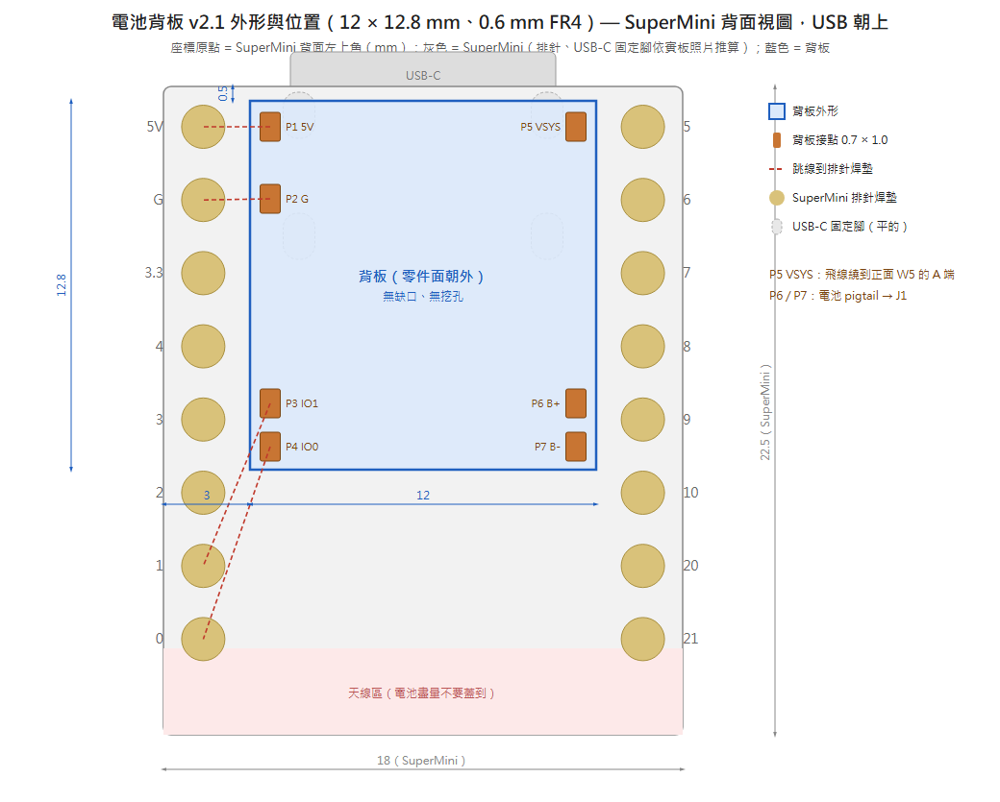

# ESP32-C3 SuperMini 電池背板 v2 — 規格總覽（0.6 mm FR4 硬板版）

一片 **12.0 × 12.8 mm、0.6 mm 厚** 的小板（v2.1），貼在 ESP32-C3 SuperMini 背面，讓 SuperMini 可以用單節鋰電池供電、USB 充電、自動切換電源，並由韌體讀取電量與充電狀態。

- 電路圖：[BACKPACK_V2_SCHEMATIC.png](BACKPACK_V2_SCHEMATIC.png)
- PCB 外形規格：[BACKPACK_V2_PCB_OUTLINE.png](BACKPACK_V2_PCB_OUTLINE.png)
- **KiCad 專案與 Gerber（可直接下單）**：[../hardware/kicad_v2](../hardware/kicad_v2)
- 設計細節與 v1 檢討：[BACKPACK_V2_DESIGN.md](BACKPACK_V2_DESIGN.md)

---

## 1. 功能

| # | 功能 | 說明 |
|---|------|------|
| 1 | **USB 充電** | 插 USB-C 就幫電池充電。TP4054 線性充電（定電流 → 定電壓 4.2 V ±1%），預設 100 mA |
| 2 | **自動電源切換（load-sharing）** | 插 USB：系統由 USB 供電，電池只充電、不承擔負載。拔 USB：自動切到電池，不斷電、不重開機 |
| 3 | **低壓降電池供電** | 電池經 P-MOS（AO3401）直接供 VSYS，壓降約 0.03 V，電池大部分電量都用得到 |
| 4 | **電池電壓偵測** | 1 MΩ / 1 MΩ 分壓 → GPIO0 (ADC1_CH0)，常駐耗電約 2 µA |
| 5 | **充電狀態輸出** | TP4054 CHRG → GPIO1，Low = 充電中；可設成「開始充電就喚醒 deep sleep」 |
| 6 | **電池可插拔** | 1.25 mm 2P 公母對插線，電池可單獨更換 |
| 7 | **低待機耗電** | 背板本身約 3 µA。整機 deep sleep 約 45 µA（需拆除 SuperMini 電源 LED） |

### 保護機制

| 保護 | 由誰負責 |
|------|----------|
| 過充（> 4.2 V） | TP4054 定電壓；電池保護板（約 4.25–4.3 V）為第二道 |
| 過放 | 韌體在 3.30 V 停止工作；電池保護板（約 2.5–3.0 V）為第二道 |
| 短路 / 過流 | 電池保護板 |
| 充電過熱 | TP4054 內建溫度調節，過熱時自動降低電流 |
| 電池反接 | TP4054 內建反接保護（仍請插前量極性） |
| 電池回灌 USB | 板上 W5（BAT60J 蕭特基二極體）阻擋 |

### 沒有的功能（限制）
- **無法分辨「已充飽」和「沒插 USB」**：兩種情況下 CHRG 都是 High。需要時可另加 VBUS 偵測。
- **沒有電池溫度偵測**：TP4054 沒有 NTC 腳位。
- **沒有充電指示燈**：裝在背面會被電池蓋住，所以沒放（電路圖中 LED1 為選配）。
- **沒有電量計**：電量百分比是由電壓查表估算，誤差約 ±10%。

---

## 2. 電氣規格

| 項目 | 規格 |
|------|------|
| 輸入（USB-C） | 5 V（TP4054 可接受 4.25–6.5 V） |
| 電池 | 單節鋰聚合物 3.7 V，**必須帶保護板**，建議 100–200 mAh |
| 充電電壓 | 4.2 V ±1% |
| 充電電流 | 100 mA（R2 = 10 kΩ）；I = 1000 V / R2，背面版不建議超過 100 mA |
| 涓流 / 截止 | 電池 < 2.9 V 時涓流預充；電流降到設定值 1/10 時停止充電 |
| VSYS（插 USB） | 約 4.7 V（USB 5 V − W5 壓降） |
| VSYS（電池） | 約 VBAT − 0.03 V |
| 3.3 V 穩壓 | 由 SuperMini 板上 ME6211 負責（最大 500 mA） |
| 可用電池電壓 | 約 3.3–4.2 V（韌體 3.30 V 截止） |
| ADC 換算 | VBAT = V(GPIO0) × 2 |
| 背板待機電流 | 約 3 µA（分壓 2 µA + TP4054 約 1 µA） |
| 整機 deep sleep | 約 45 µA（拆電源 LED 後） |
| 續航參考 | 每天喚醒 2 次、每次 WiFi 約 1 分鐘：200 mAh 約 5–6 週 |

---

## 3. 接點定義

| 接點 | 網路 | 接到 SuperMini | 連接方式 |
|------|------|----------------|----------|
| P1 | VBUS | **5V** 焊墊 | 0.3 mm 鍍錫線短跳線 |
| P2 | GND | **G** 焊墊 | 0.3 mm 鍍錫線短跳線 |
| P3 | CHRG | **GPIO1** 焊墊 | 0.3 mm 鍍錫線（約 6 mm） |
| P4 | VBAT/2 | **GPIO0** 焊墊 | 0.3 mm 鍍錫線（約 7 mm） |
| P5 | VSYS | **W5 的 A 端**（正面，靠板邊那端） | 28–30 AWG 飛線繞過板邊 |
| P6 | BAT+ | — | 電池 pigtail 紅線 → J1 |
| P7 | BAT− | — | 電池 pigtail 黑線 → J1 |

- **用到的 GPIO**：只有 GPIO0、GPIO1，和 E-Paper（GPIO2/3/4/5/6/10）不衝突。
- **不用接**：3.3 V。

---

## 4. 零件清單（BOM）

| 編號 | 零件 | 規格 | 封裝 | 數量 |
|------|------|------|------|------|
| U1 | 鋰電池充電 IC | TP4054 | SOT-23-5 | 1 |
| Q1 | P-MOSFET | AO3401（印字 A19T） | SOT-23 | 1 |
| R1 | 電阻 | 100 kΩ | 0603 | 1 |
| R2 | 電阻 | 10 kΩ（設定 100 mA） | 0603 | 1 |
| R3、R4 | 電阻 | 1 MΩ 1% | 0603 | 2 |
| C1 | 電容 | 1 µF / 10 V X5R | 0603 | 1 |
| C2 | 電容 | 10 µF / 10 V X5R | 0805 | 1 |
| C3 | 電容 | 22 µF / 10 V X5R | 0805 | 1 |
| C4 | 電容 | 100 nF | 0603 | 1 |
| J1 | 電池連接器 | 1.25 mm 2P 公母對插線（MX1.25 / PicoBlade 相容） | 線材 | 1 組 |
| BAT | 鋰聚合物電池 | 402020（~110 mAh）或 502020（~150 mAh），帶保護板 | — | 1 |

不裝：R5、LED1、R6、2N7002。

---

## 5. PCB 製作規格（給打樣廠）

| 項目 | 規格 |
|------|------|
| 板材 / 板厚 | FR4，**0.6 mm**（0.4 mm 只能選 ENIG/OSP，報價 US$33–50；0.6 mm 約 US$5.5 / 5 片） |
| 層數 / 銅厚 | 2 層，1 oz |
| 外形 | 12.0 × 12.8 mm 矩形，無缺口、無 NPTH 孔（實板 USB-C 固定腳焊點是平的） |
| 表面處理 | LeadFree HASL（無鉛噴錫） |
| 防焊 / 絲印 | 雙面防焊；Top 面絲印（零件編號、P1–P7、電池 +/−） |
| 最小線寬 / 線距 | 0.2 / 0.2 mm |
| 電源走線 | VBAT、VSYS、GND ≥ 0.5 mm |
| Top 面 | 全部零件（朝外，背對 SuperMini） |
| Bottom 面 | GND 鋪銅並全面覆蓋防焊，**不放零件**（貼在 SuperMini 背面） |
| 接點 | P1–P7 邊緣焊墊 0.7 × 1.0 mm |
| 禁布 | 銅箔距板框 ≥ 0.3 mm；板子不延伸到天線區 |

> 外形圖中 SuperMini 的排針與 USB-C 固定腳位置是依 2026-10-23 實板照片推算（±0.3 mm）。背板沒有對位孔，位置誤差只影響跳線長短。

---

## 6. 機構與疊層

| 層（由正面往背面） | 厚度 (mm) |
|--------------------|-----------|
| 正面零件 / USB-C | 3.2 |
| SuperMini PCB | 1.0 |
| Kapton + 雙面膠 | 0.15 |
| 背板 PCB | 0.6 |
| 背板零件（SOT-23 最高） | 1.1 |
| 泡棉雙面膠 | 0.8 |
| 電池 502020（402020） | 5.0（4.0） |
| **總厚** | **約 11.9（10.9）** |

| 方向 | 尺寸 |
|------|------|
| 長 | 22.5 mm（同 SuperMini，電池不超出 USB 端） |
| 寬 | 約 22.5 mm（含右側 J1 接頭，約 4.5 mm） |

- **J1**：平躺在右側板邊外（GPIO5–21 那側），和電池同一層，不增加厚度。
- **天線**：電池盡量不要蓋到 SuperMini 最下方約 3 mm 的天線區。

---

## 7. 組裝前，SuperMini 要做的改造

1. **拆除電源 LED**：「PW」旁的紅色 LED 或它的電阻。不拆的話每天多耗約 9 mAh。
2. **W5 保持完整**：如果之前改過（抬過一端），要焊回去。
3. **確認 W5 的 A 端**：三用電表二極體檔，紅棒接 5V，黑棒碰 W5 兩端，讀到 0.2–0.35 V 的那端就是 A（VSYS）。

## 8. 組裝順序

1. 焊好背板的零件。
2. **上電前量測**（二極體檔）：紅棒 VBAT、黑棒 VSYS 應讀到 0.5–0.7 V，反過來要不通。
3. SuperMini 背面貼 Kapton，露出 5V、G、GPIO1、GPIO0 焊墊。
4. 背板用雙面膠貼上。
5. 跳線 P1–P4，並把 P5 飛線焊到 W5 的 A 端。
6. 焊電池 pigtail 到 P6/P7，接上 J1。**插電池前先量極性。**
7. **功能測試**：
   - 插拔 USB 時系統不重開機。
   - 充飽後拔掉 USB，電池電壓 ≤ 4.2 V。
   - 電池供電時 deep sleep 電流約 45 µA。
8. 貼泡棉膠、放上電池，J1 用 Kapton 固定在電池側面。
