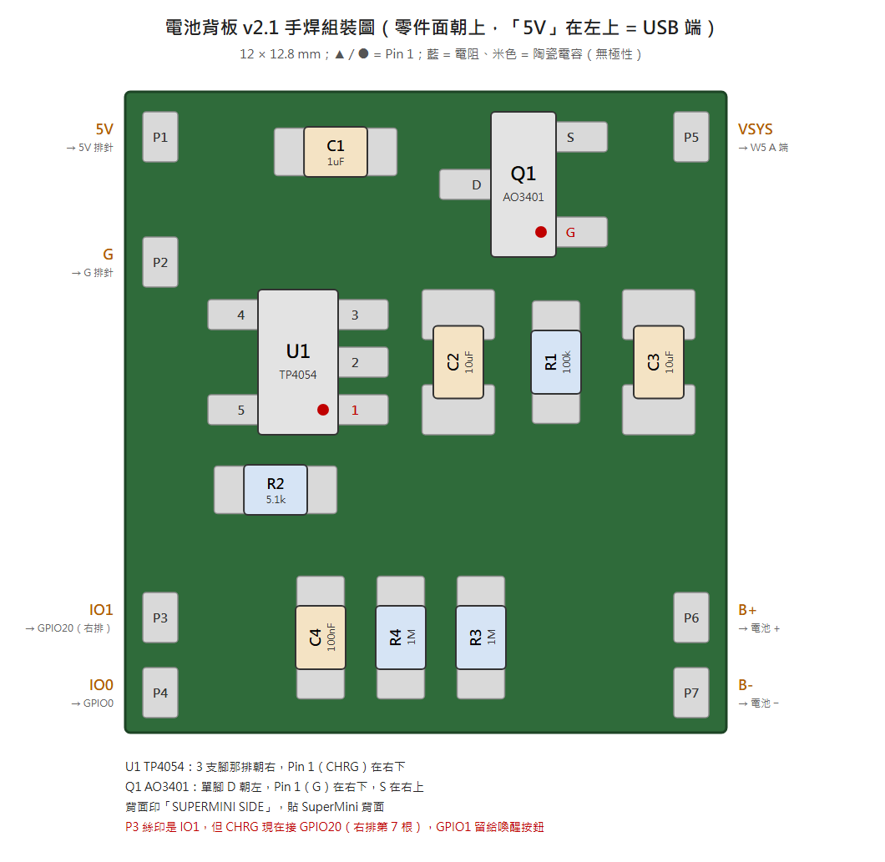

# 電池背板 v2.1 — BOM（零件清單）

PCB：`C3_Battery_Backpack_v2.1_Gerber.zip`（12.0 × 12.8 mm，0.6 mm FR4）。零件全部焊在 Top 面，手焊。
零件位置與方向對照 **[`ASSEMBLY.png`](ASSEMBLY.png)**（手焊組裝圖，有零件編號），電路對照 [`C3_Battery_Backpack_schematic.pdf`](C3_Battery_Backpack_schematic.pdf)。

## 背板零件

| 編號 | 零件 | 規格 | 封裝 | 數量 | 備註 |
|---|---|---|---|---|---|
| U1 | 鋰電池充電 IC | TP4054 | SOT-23-5 | 1 | 4.2 V ±1%。同腳位替代：LTC4054ES5-4.2 |
| Q1 | P-MOSFET | AO3401 / AO3401A（印字 A19T） | SOT-23 | 1 | 替代：SI2301CDS、DMG2305UX |
| R1 | 電阻 | 100 kΩ | 0603 | 1 | Q1 Gate 下拉 |
| R2 | 電阻 | 5.1 kΩ | 0603 | 1 | 充電電流 196 mA（I = 1000 V / R2），給 ≥ 400 mAh 電池。**小電池要改 10 kΩ**，見下方 |
| R3、R4 | 電阻 | 1 MΩ **1%** | 0603 | 2 | VBAT 分壓，精度影響電量讀數 |
| C1 | 電容 | 1 µF / 10 V X5R | 0603 | 1 | TP4054 VCC。**不要加大**，會拖慢拔 USB 後的切換 |
| C2、C3 | 電容 | 10 µF / 10 V X5R | 0805 | 2 | C2 在 VBAT；C3 在 VSYS，WiFi 發射瞬間補強（原 22 µF，2026-10-31 改 10 µF 與 C2 共用料；要加大可換 22 µF 0805 陶瓷，例如 Samsung CL21A226MPQNNNE） |
| C4 | 電容 | 100 nF / 16 V X7R | 0603 | 1 | ADC 取樣 |

小計：8 種、10 顆。

## 線材與電池

| 項目 | 規格 | 數量 | 備註 |
|---|---|---|---|
| J1 電池連接線 | 1.25 mm 2P 公母對插線（MX1.25 / Molex PicoBlade 相容） | 1 組 | 板端焊 P6（B+）/ P7（B−）。**每顆電池插上前先量極性** |
| 電池 | 單節 LiPo，帶保護板，**≥ 400 mAh**（例如 500 mAh）。用 402020（約 110 mAh）、502020（約 150 mAh）這類小電池時 R2 要改 10 kΩ | 1 | 保護板出線朝右（GPIO5–21 那側） |
| 跳線 | 0.3 mm 鍍錫線 / 30 AWG | 約 15 mm | P1、P2、P4 到 SuperMini 左排排針 |
| CHRG 線 | 30 AWG 絕緣線 | 約 15 mm | P3 橫越背板到右排 **GPIO20**（板上絲印 IO1） |
| VSYS 飛線 | 28–30 AWG 絕緣線 | 約 20 mm | P5 到正面 W5 的 A 端 |
| 絕緣 / 固定 | Kapton 膠帶、0.5–1 mm 泡棉雙面膠 | 少量 | |

## 不裝

R5、R6、LED1（充電指示，背板版看不到）、2N7002（v1 的 ADC 開關，v2 不需要）。

## 依電池容量調整 R2

| 電池容量 | R2 | 充電電流 |
|---|---|---|
| 100–400 mAh | 10 kΩ | 100 mA |
| ≥ 400 mAh（例如 500 mAh） | **5.1 kΩ**（預設） | 196 mA |

原則是充電電流 ≤ 0.5 C。TP4054 規格上限 500 mA（2 kΩ），但這片板子很小、又壓在電池下面，R2 不要小於 5.1 kΩ：電流再大，多出來的大多變成熱，晶片也會過熱降流。
