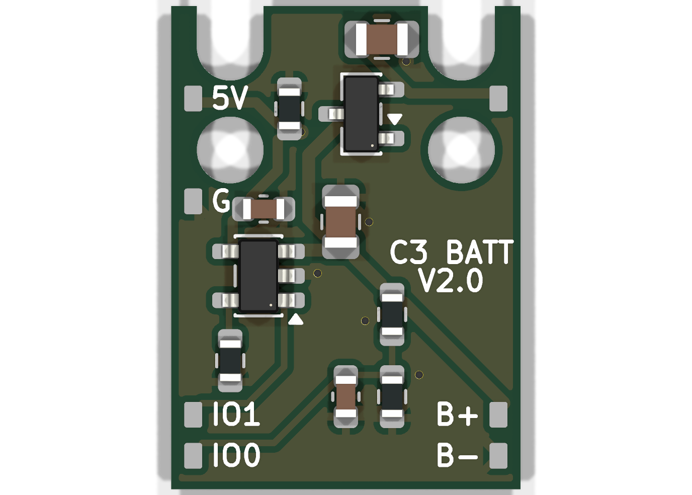

# KiCad 版電池背板 v2（程式自動產生）

做法同 `switch_relay_Control/D1mini_Fixture_Shield_HW/kicad`：用 KiCad 10.0.7 的 Python 介面產生電路圖與 PCB，格點自動佈線（雙層 + 過孔），再用 `kicad-cli` 做 ERC / DRC 並匯出 Gerber。

## 結果

- **ERC：0 錯誤**（只有 7 個「自製 footprint 庫不在庫表」的提示）
- **DRC：0 錯誤、0 未連接**（同樣只剩 7 個自製 footprint 庫的提示）
- **電路圖網路表與 PCB 的 7 條網路逐條比對，完全一致**
- 板子 13.6 × 18.8 mm、**板厚 0.6 mm**、雙層 1 oz
  - 上緣 2 個 U 形缺口、中間 2 個 Ø2.6 mm 孔，避開 SuperMini 背面 USB-C 固定腳
- 走線 40 段、過孔 8 個（0.6 / 0.3 mm）
  - 線寬：VBAT 0.5 mm；VBUS、VSYS、GND 0.4 mm；訊號 0.25 mm
  - 兩面鋪 GND
- 設計規則（寫在 `C3_Battery_Backpack.kicad_pro`）：
  - 線寬 / 線距 ≥ 0.15 mm
  - 銅箔到板框 ≥ 0.3 mm（JLCPCB 能力 0.2 mm）
  - 絲印字高 0.8 mm、筆畫 0.15 mm



## 給板廠的檔案

**`C3_Battery_Backpack_v2.0_Gerber.zip`**：直接上傳 JLCPCB。內含：

| 檔案 | 內容 |
|---|---|
| `*-F_Cu.gtl` / `*-B_Cu.gbl` | 頂層 / 底層銅箔 |
| `*-F_Mask.gts` / `*-B_Mask.gbs` | 防焊 |
| `*-F_Silkscreen.gto` / `*-B_Silkscreen.gbo` | 絲印 |
| `*-Edge_Cuts.gm1` | 板框（含缺口與圓孔） |
| `*.drl` | 鑽孔（過孔，Excellon，mm） |
| `*-job.gbrjob` | 工作檔 |

### 下單參數（JLCPCB）

| 項目 | 設定 |
|---|---|
| Base Material / Layers | FR-4，2 層 |
| Dimensions | 13.6 × 18.8 mm（上傳 Gerber 後會自動帶入） |
| **PCB Thickness** | **0.6 mm** |
| Surface Finish | LeadFree HASL（無鉛噴錫） |
| Outer Copper Weight | 1 oz |
| 其他 | 綠漆白字；其餘預設 |

2026-10-23 線上報價：5 片約 **US$5.5**（不含運費）。

- 0.4 mm 板厚只能選 ENIG 或 OSP，報價會跳到 US$33–50，所以改用 0.6 mm。
- 下單前請在 JLCPCB 的 Gerber Viewer 再看一次板框和缺口。

> ⚠️ **下單前請用卡尺量 SuperMini 實板**：
> - 背面 4 個 USB-C 固定腳凸點的位置，對照 `geom.py` 的 `NOTCHES` / `HOLES`（背板座標 = SuperMini 背面座標 −(2.2, 0.4)）。
> - 排針焊墊位置。
>
> 若不符，改 `geom.py` 後重新產生即可。

## 板上接點

| 接點 | 絲印 | 網路 | 接到 |
|---|---|---|---|
| P1 | 5V | VBUS | SuperMini 5V 焊墊（短跳線） |
| P2 | G | GND | SuperMini G 焊墊 |
| P3 | IO1 | CHRG | GPIO1 |
| P4 | IO0 | VBAT/2 | GPIO0 |
| P5 | （右上，無字） | VSYS | 飛線到正面 W5 的 A 端 |
| P6 | B+ | VBAT | 電池 + |
| P7 | B- | GND | 電池 − |

零件代號沒有印在板上（板子太小），手焊時對照 `render_top.png` 或 `../../docs/BACKPACK_V2_LAYOUT.png`。

背面絲印「SUPERMINI SIDE」，表示這面貼 SuperMini。

## 重新產生

```bash
python gen_sch.py
"D:\Program Files\KiCad\bin\python.exe" build_pcb.py --route
"D:\Program Files\KiCad\bin\kicad-cli.exe" sch erc --format json --severity-all -o erc.json C3_Battery_Backpack.kicad_sch
"D:\Program Files\KiCad\bin\kicad-cli.exe" pcb drc --format json --severity-all -o drc.json C3_Battery_Backpack.kicad_pcb
"D:\Program Files\KiCad\bin\kicad-cli.exe" pcb export gerbers -o gerber --layers F.Cu,B.Cu,F.Mask,B.Mask,F.Silkscreen,B.Silkscreen,Edge.Cuts C3_Battery_Backpack.kicad_pcb
"D:\Program Files\KiCad\bin\kicad-cli.exe" pcb export drill -o gerber/ --format excellon --excellon-units mm C3_Battery_Backpack.kicad_pcb
```

| 檔案 | 用途 |
|---|---|
| `geom.py` | 板子尺寸、板厚、USB-C 固定腳缺口位置（共用） |
| `gen_sch.py` | 產生電路圖 `C3_Battery_Backpack.kicad_sch` |
| `build_pcb.py` | 放零件、接點 footprint、網路、板框、絲印 |
| `route.py` | 自動佈線（A* 格點、雙層）與兩面鋪 GND |
| `erc.json` / `drc.json` | 最近一次 ERC / DRC 報告 |
| `gerber/` | Gerber 與鑽孔原始輸出 |
| `render_top.png` / `render_bottom.png` / `top.svg` / `bottom.svg` | 預覽 |
